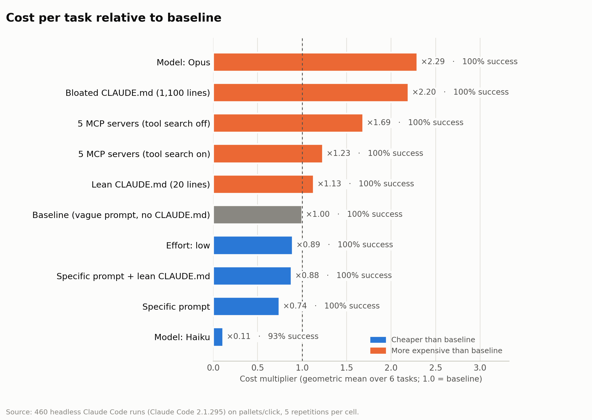
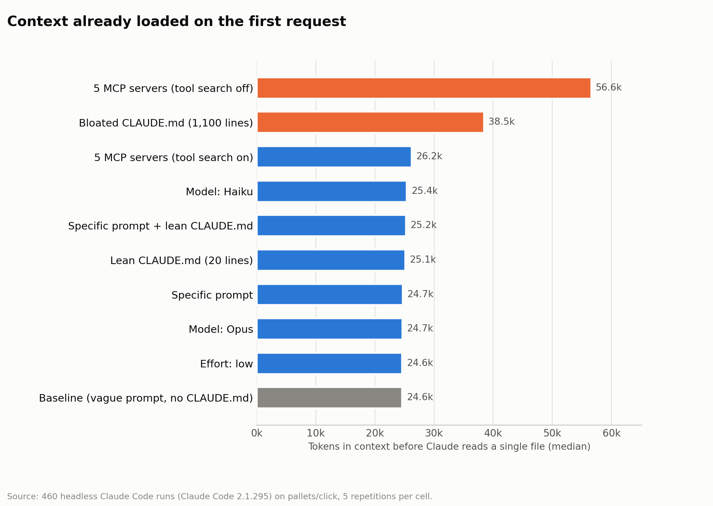
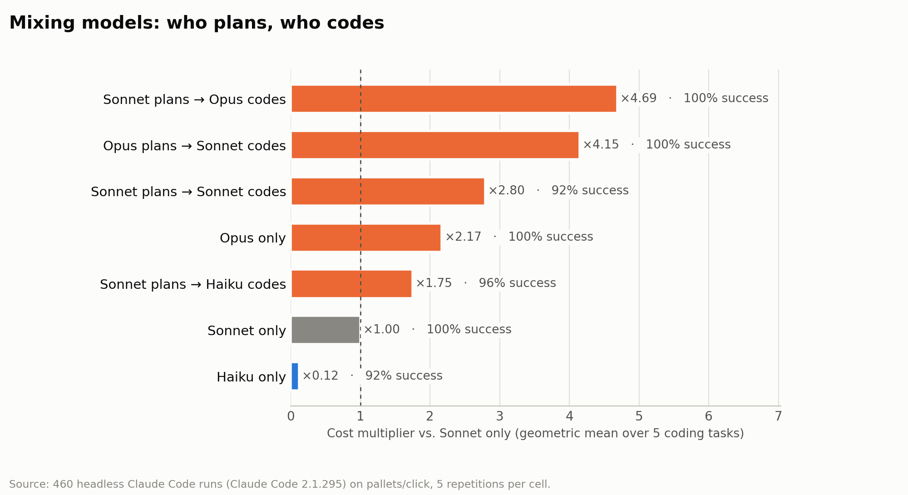
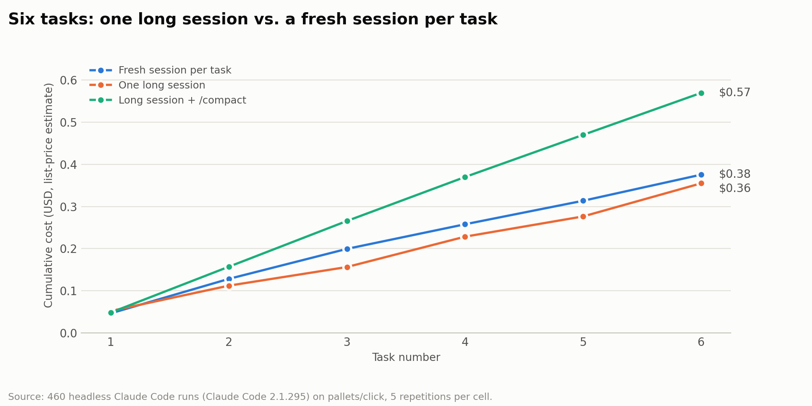

# Claude Code Token Efficiency Benchmark

**This benchmark measures which Claude Code habits actually save tokens.** I injected bugs into a real
codebase and graded every fix with hidden tests. Claude Code ran headlessly **460 times** across
**16 configurations**, and each run's tokens, cost, turns and pass/fail were recorded.

Most advice about using AI coding agents cheaply is untested. This repository contains the
harness, the tasks, the hidden tests, every raw result and the analysis, so you can check the
findings or rerun them on your own setup.



## Key findings

The multipliers compare each condition's cost to the baseline, with 95% bootstrap confidence intervals.

| Condition | Cost vs baseline | 95% CI | Success |
|---|---|---|---|
| Model: Haiku 5.5 | **0.11×** | 0.10–0.13 | 93% |
| Specific prompt (file + symptom + test command) | **0.74×** | 0.65–0.82 | 100% |
| Specific prompt + lean CLAUDE.md | 0.88× | 0.80–1.00 | 100% |
| Effort: low | 0.89× | 0.81–1.01 | 100% |
| **Baseline**: Sonnet 5.5, vague prompt | 1.00× | 0.89–1.12 | 100% |
| Lean CLAUDE.md (20 lines) | 1.13× | 1.01–1.27 | 100% |
| 5 MCP servers, tool search on (default) | 1.23× | 1.07–1.38 | 100% |
| 5 MCP servers, tool search off | 1.69× | 1.54–2.07 | 100% |
| Bloated CLAUDE.md (1,100 lines) | 2.20× | 2.01–2.49 | 100% |
| Model: Opus 5.5 | 2.29× | 2.05–2.71 | 100% |
| Sonnet plans → Haiku codes | 1.75× | 1.48–2.29 | 96% |
| Plan mode (Sonnet plans → Sonnet codes) | 2.80× | 2.28–3.59 | 92% |
| Opus plans → Sonnet codes (`opusplan`) | 4.15× | 3.75–5.19 | 100% |
| Sonnet plans → Opus codes | 4.69× | 4.05–5.97 | 100% |

In short:

1. **Specific prompts are the cheapest win.** Naming the file, the symptom and the test command cut cost by 26% with no loss in success.
2. **Model choice dominates.** Haiku used about 2× the tokens of Sonnet but cost about 9× less, because its per-token list price is 20× lower. It only failed on the vaguest prompt.
3. **Whatever you put into the context, you pay for on every request.** A bloated CLAUDE.md cost 2.2×. Five MCP servers cost 1.23× even with tool search on, and 1.69× with it off.
4. **Plan mode and model mixing don't pay off on everyday tasks.** The planning step alone was about two-thirds of the bill.
5. **`/compact` between small tasks backfires.** It cost 52% more than starting a fresh session for each task. Carrying context forward cost nothing extra at this scale, because cached tokens are cheap.

## What happens before you type



On its first request, Claude Code already sends **16–25k tokens** of system prompt and tool
definitions, before reading any file. The exact amount depends on the subscription. That load is
re-sent on every turn. A bloated CLAUDE.md adds 14k tokens to it. MCP servers with tool search off
roughly double it.

## Models and planning



Each coding task ran in two steps: first a plan-mode call, then `"The plan is approved. Implement it now."`
in the same session. No planning combination beat handing the task straight to Sonnet or Haiku.
The plan-mode failures all came from the vaguest prompt. Claude found no bug while planning, so it
asked for clarification and nobody answered.

## Session strategies



The same six tasks ran three ways: in a fresh session each (the same effect as `/clear`), in one
long session, and in one long session with `/compact` between tasks. The long session and the
fresh sessions are within noise of each other ($0.36 vs $0.38). `/compact` pays for a summary
*and* discards the warm cache, which brought the total to $0.57.

## Benchmark design

### Codebase and tasks

The target is [pallets/click](https://github.com/pallets/click) 8.5.0, about 29k lines of Python
including tests. [`harness/build_template.py`](harness/build_template.py) builds the workspace
template:

- It injects four bugs.
- It removes the upstream tests that would expose them, so the visible suite still passes. This simulates a real coverage gap.
- It starts a fresh git history, so `git log` can't reveal the bugs.

| Task | Kind | Vague prompt (baseline) |
|---|---|---|
| `t1_intrange` | Bug fix | "Integer range options with clamping return values outside the allowed range." |
| `t2_help_order` | Bug fix | "The --help output looks wrong: options are listed in a weird order." |
| `t3_completion_hash` | Bug fix | "Shell completion gives wrong results when an argument contains a # character." |
| `t4_keyvalue` | Feature | "Add a parameter type `click.KeyValue` that parses `key=value` strings…" |
| `t6_default_map` | Bug fix | "Defaults configured through `default_map` are ignored for subcommands." |
| `t5_value_source` | Question | "How does click decide where an option's value comes from?" |

Every task also has a **specific** prompt that names the file, the symptom and the verification
command. Both versions of each prompt are in [`harness/tasks.json`](harness/tasks.json).

### Grading

- **Code tasks** pass only if the hidden tests in [`grading/`](grading/) pass *and* the full
  existing suite still passes. A failing suite is rerun once to filter out flaky tests.
- **The question task** passes if the answer names the key mechanisms (`consume_value`,
  `default_map` and `ParameterSource` or its members) and no files were modified.

### Conditions

The **baseline** is Claude Sonnet 5.5 at default effort, with the vague prompt, no CLAUDE.md, no MCP
servers and a fresh session per task. Each condition changes exactly one factor:

| Group | Conditions |
|---|---|
| Prompt | `specific_prompt` |
| CLAUDE.md | `claudemd_lean` ([lean.md](harness/claudemd/lean.md)), `claudemd_bloated` ([generator](harness/make_bloated_claudemd.py)) |
| MCP | `mcp_heavy`: 5 servers, tool search on; `mcp_heavy_eager`: tool search off (`ENABLE_TOOL_SEARCH=false`) |
| Model / effort | `model_haiku`, `model_opus`, `effort_low` |
| Combined | `best_practice`: specific prompt + lean CLAUDE.md |
| Plan mode | `plan_mode`, `plan_opus_exec_sonnet`, `plan_sonnet_exec_haiku`, `plan_sonnet_exec_opus` |
| Sessions | `long_session`: 6 tasks in one resumed session; `long_session_compact`: the same with `/compact` between tasks |

**Run counts:** 10 single-factor conditions × 6 tasks × 5 reps = 300.
4 plan conditions × 5 coding tasks × 5 reps = 100. 2 session strategies × 5 sequences × 6 tasks = 60.
**Total: 460.**

### Isolation

Each run copies the template into a fresh workspace and runs:

```
claude -p "<prompt>" --output-format json --model <model> \
  --setting-sources project --strict-mcp-config --disable-slash-commands \
  --permission-mode bypassPermissions --max-turns 80 --session-id <uuid>
```

- User settings, user MCP servers and skills are excluded, and auto memory is disabled.
- `--disable-slash-commands` also blocks `/compact`, so it is lifted for the `/compact` call only.
- `ANTHROPIC_API_KEY` is removed from the environment, so subscription runs can't silently bill an API key.
- Conditions are interleaved in a seeded random order, so time-of-day effects spread evenly across them.

### Metrics and statistics

- **Cost** is Claude Code's own `total_cost_usd`, a list-price estimate that includes subagents.
  Recomputing it from raw token counts at list prices reproduces it to the cent.
- **Context sizes** per request come from the session transcript.
- A condition's **cost multiplier** works as follows:
  1. For each task, divide the median cost over 5 runs by the baseline's median.
  2. Take the geometric mean of those per-task ratios.
- **95% CIs** come from a bootstrap that resamples runs within every condition × task cell, 2,000 iterations.
- On `--resume`, Claude Code reports cumulative cost. For session strategies, the last step of
  each sequence therefore holds the total.

## Repository layout

```
harness/
  build_template.py          # builds the benchmark workspace from click 8.5.0
  tasks.json                 # six tasks, each with a vague and a specific prompt
  claudemd/                  # lean and bloated CLAUDE.md variants
  make_bloated_claudemd.py   # generates the bloated variant
  mcp/package.json           # MCP servers used by the MCP conditions (pinned)
  runner.py                  # runs conditions, records results, grades (resumable)
  analyze.py                 # medians, ratios, bootstrap CIs, account-stratified check
  charts.py                  # renders figures/ (English and Turkish)
grading/                     # hidden tests, never visible to Claude
results/
  runs.jsonl                 # one record per run (config, tokens, cost, turns, grade)
  summary.md                 # analysis tables
  summary_runs.json          # the same, machine-readable
runs/<run_id>/               # raw Claude Code JSON output and the final diff of every run
figures/                     # charts
```

## Reproduce

Requirements: Python 3.11+, Node 18+, git, and a logged-in Claude Code (a subscription or an API key).

```bash
# 1. Benchmark workspace
git clone https://github.com/pallets/click.git upstream-click
git -C upstream-click checkout 8.5.0
python -m venv venv && venv/bin/pip install pytest ./upstream-click   # Windows: venv\Scripts\pip
python harness/build_template.py
python harness/make_bloated_claudemd.py

# 2. MCP servers (only needed for the MCP conditions)
npm install --prefix harness/mcp

# 3. Pin the Claude Code version used in the study
npm install --prefix cli295 @anthropic-ai/claude-code@2.1.295
export CLAUDE_BIN=$PWD/cli295/node_modules/.bin/claude   # Windows: cli295\node_modules\.bin\claude.cmd

# 4. Run, analyze, plot
python harness/runner.py                          # all conditions × 5 reps (resumable)
python harness/runner.py --only baseline,specific_prompt --reps 1   # quick smoke test
python harness/analyze.py results/runs.jsonl
python harness/charts.py                          # requires matplotlib
```

> **Cost warning.** A full run is about 590 Claude Code calls. On a subscription it will hit the
> 5-hour usage limit more than once. The runner detects rate limits, pauses and retries, and it
> skips completed runs on restart.

## Limitations

- **Small, well-scoped tasks on one Python codebase.** Sonnet solved all of them, so the results
  say more about cost than about capability. Large, ambiguous or multi-hour work is untested.
- **Two subscriptions.** Runs were split across a Team and a Pro subscription when one hit its
  usage limit. Their system context differs by about 8.6k tokens. `analyze.py` also computes every
  ratio within each account, and the results agree with the pooled ones.
- **Nondeterminism.** With 5 repetitions per cell, treat differences under about 10% as noise.
- **Cost is a list-price estimate.** On a subscription, the same tokens count against your usage limit instead.

## Notes

- `results/runs.jsonl` keeps the rate-limited attempts (`"status": "rate_limited"`). They are
  excluded from analysis and rerun from scratch.
- Local file paths in the raw outputs were anonymized to `<home>` and `<repo>`.
- click is © Pallets and BSD-3-Clause licensed. This repository does not redistribute its
  source; it is cloned at build time.
